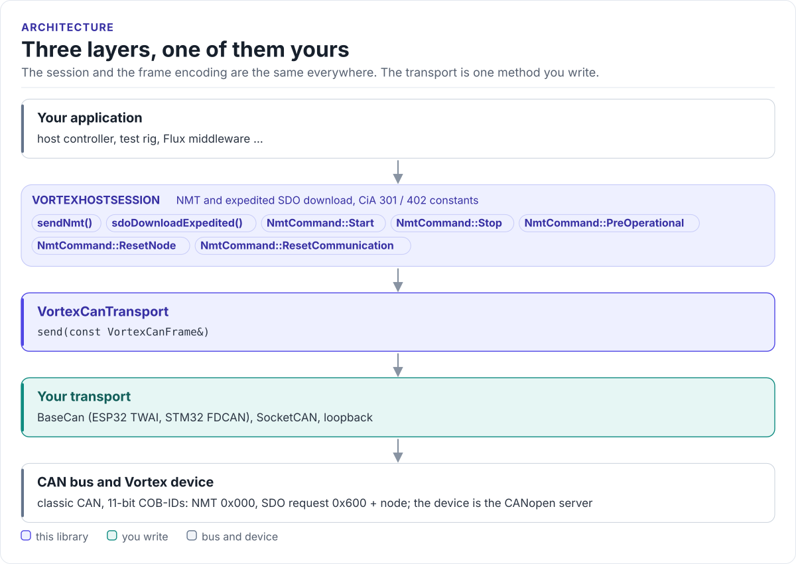

# Vortex Driver

A C++20 CANopen host client for HardFOC Vortex devices: NMT commands and expedited SDO writes with named CiA 301
and CiA 402 objects, over a CAN transport you provide.

[](https://github.com/hardfoc/hf-vortex-driver/actions/workflows/ci-generic.yml)
[](https://hardfoc.github.io/hf-vortex-driver/)
[](LICENSE)

**Documentation: <https://hardfoc.github.io/hf-vortex-driver/>**

<!-- figure: driver-layers -->
<picture>
  <source media="(prefers-color-scheme: dark)" srcset="docs/diagrams/driver-layers.dark.svg">
  
</picture>
<!-- /figure -->

## In 30 seconds

Implement `VortexCanTransport::send()` for your CAN driver
([Porting](https://hardfoc.github.io/hf-vortex-driver/latest/porting/)), then:

<!-- generated: quickstart-code -->
```cpp
#include "vortex/VortexHostSession.hpp"
#include "vortex/VortexProtocol.hpp"

using namespace hf::vortex;

// Put node 5 in Operational and select CiA 402 profile velocity mode (3).
bool start_node_in_velocity_mode(VortexCanTransport& bus) {
    VortexHostSession session(bus);
    constexpr std::uint8_t kNode = 5;

    if (!session.sendNmt(NmtCommand::Start, kNode)) {               // 0x000: 01 05
        return false;                                               // transport refused the frame
    }
    return session.sdoDownloadExpedited(kNode, kIdxModesOfOperation, // 0x605: 2F 60 60 00 03
                                        /*sub=*/0, /*value=*/3, /*size=*/1);
}
```
<!-- /generated -->

## What it does

- `sendNmt()`: Start, Stop, Pre-operational, Reset node, Reset communication, to one node or all.
- `sdoDownloadExpedited()`: writes 1, 2 or 4 bytes to any object, with the CiA 301 command specifier.
- Named objects: controlword, statusword, modes of operation, actual position and velocity, error register, a
  HardFOC vendor range.
- One virtual method to port; a `BaseCan` adapter is ten lines.
- No heap, no threads, no RTOS; transmit only (read responses with hf-utils-canopen or CANopenNode).

## Install

```bash
git submodule add https://github.com/hardfoc/hf-vortex-driver.git external/hf-vortex-driver
```

```cmake
add_subdirectory(external/hf-vortex-driver)
target_link_libraries(my_app PRIVATE hf_vortex_driver)
```

## Documentation

| | |
| --- | --- |
| [Quickstart](https://hardfoc.github.io/hf-vortex-driver/latest/quickstart/) | Wire the bus, write the transport, start a node |
| [Hardware](https://hardfoc.github.io/hf-vortex-driver/latest/hardware/) | Bus settings, COB-IDs, frame bytes, objects |
| [API guide](https://hardfoc.github.io/hf-vortex-driver/latest/api-guide/) | NMT, SDO, the CiA 402 state machine |
| [Porting](https://hardfoc.github.io/hf-vortex-driver/latest/porting/) | The transport contract and a BaseCan adapter |
| [API reference](https://hardfoc.github.io/hf-vortex-driver/latest/api/) | Doxygen |

## Tests

```bash
cmake -B build -S . -DHF_VORTEX_BUILD_DOC_SNIPPETS=ON && cmake --build build && ctest --test-dir build
```

## License

GPL-3.0; see [LICENSE](LICENSE).
