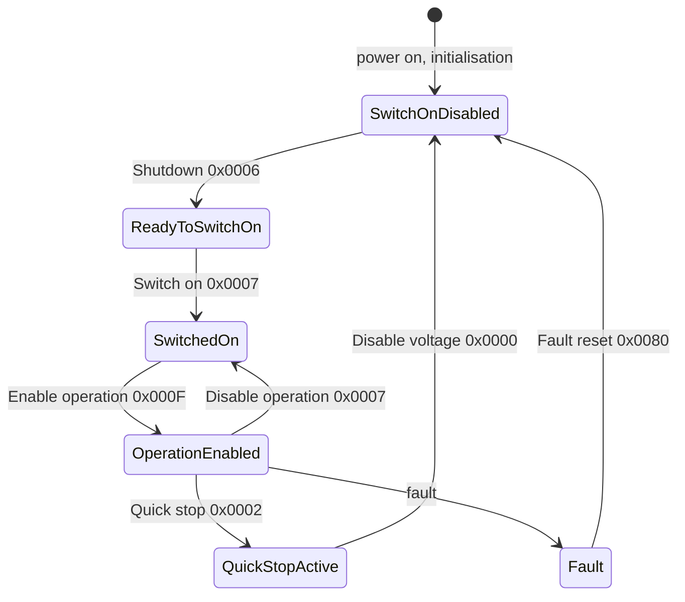

# API guide

Send NMT commands, write objects and walk a drive through the CiA 402 state machine, with code that compiles and
is checked byte for byte.

## The shape of the API

Everything is in namespace `hf::vortex`; include `vortex/VortexHostSession.hpp` (it includes the others).

| Type | What it is |
| --- | --- |
| `VortexHostSession` | The client: `sendNmt()`, `sdoDownloadExpedited()`, `transport()` |
| `VortexCanTransport` | The interface you implement: `bool send(const VortexCanFrame&)` |
| `VortexCanFrame` | `id`, `dlc`, `extended`, `rtr`, `data[8]`, `pad()` |
| `NmtCommand` | NMT command bytes (`VortexProtocol.hpp`) |
| `kIdx*`, `kSub*` | Object indices ([table](hardware.md#object-dictionary-constants)) |

Every call returns `bool`: true when your transport accepted the frame. Nothing waits for the node.

## Create a session

```cpp
hf::vortex::VortexHostSession session(transport);   // transport: your VortexCanTransport
```

The session stores a reference: keep the transport alive as long as the session. It is cheap to create one per
use.

## NMT

`sendNmt(command, node)` sends a two-byte NMT frame. Node 0 addresses every node on the bus.

```cpp
--8<-- "tests/docs/api_tasks.cpp:nmt"
```

| Command | Node goes to |
| --- | --- |
| `NmtCommand::Start` | Operational: PDOs run |
| `NmtCommand::Stop` | Stopped: only NMT and heartbeat |
| `NmtCommand::PreOperational` | Pre-operational: SDO works, PDOs do not |
| `NmtCommand::ResetNode` | Full application reset, then boot-up |
| `NmtCommand::ResetCommunication` | Communication objects reset, then boot-up |

## Write an object (SDO download)

`sdoDownloadExpedited(node, index, sub, value, size)` writes `size` bytes (1, 2 or 4) of `value`, low byte first.
Any other size returns false without sending.

```cpp
--8<-- "tests/docs/api_tasks.cpp:sdo"
```

Use the size of the object's data type in the EDS: `UNSIGNED8` / `INTEGER8` 1, `UNSIGNED16` / `INTEGER16` 2,
`UNSIGNED32` / `INTEGER32` 4. Pass negative values as their two's-complement bit pattern.

## Enable a CiA 402 drive

A CiA 402 drive moves through its power state machine when you write commands to the controlword (`0x6040`) and
reports its state in the statusword (`0x6041`):



Disable voltage (`0x0000`) also returns Ready to switch on and Switched on to Switch on disabled.

```cpp
--8<-- "tests/docs/api_tasks.cpp:cia402"
```

Select the mode of operation (`0x6060`) before enabling: 1 profile position, 3 profile velocity, 4 profile
torque, 6 homing, 8 / 9 / 10 cyclic synchronous position / velocity / torque, as far as the device supports them.

## What the session does not do

| Need | Use |
| --- | --- |
| SDO response or abort, expedited SDO upload (read an object) | Your CAN receive path with `CanOpen::ParseSdoResponse()` from `CanOpenExtras.h` in [hf-utils-canopen](https://github.com/hardfoc/hf-utils-canopen) |
| Drive state from the statusword | `CanOpen::DecodeStatusWord()` and `CanOpen::NextControlWord()` in the same header |
| Heartbeat, EMCY | `CanOpen::ParseHeartbeat()`, `CanOpen::ParseEmergency()` in the same header |
| Segmented or block SDO (more than 4 bytes), PDO, SYNC | A CANopen stack (CANopenNode); configure the node's PDO mapping with SDO writes |
| Retries and timeouts | Your application: the session sends once |

Next: [Porting](porting.md).
