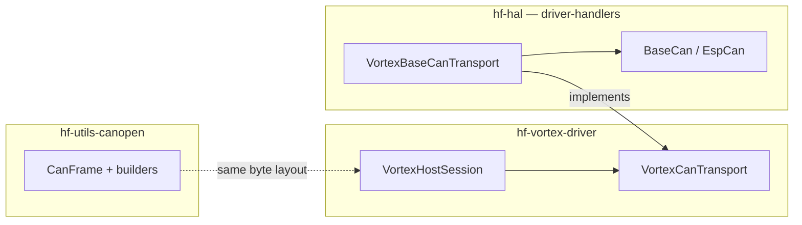

# Architecture

- **Override point:** subclass `VortexCanTransport` (or use `VortexBaseCanTransport` in HAL) — same idea as `Tmc9660SpiCommInterface` + `BaseSpi`, not CRTP.
- **CANopenNode** (optional) sits beside application code: `CO_driver` calls `BaseCan`, not the reverse.

⬅ [integration.md](integration.md) · [Back to index](index.md)
