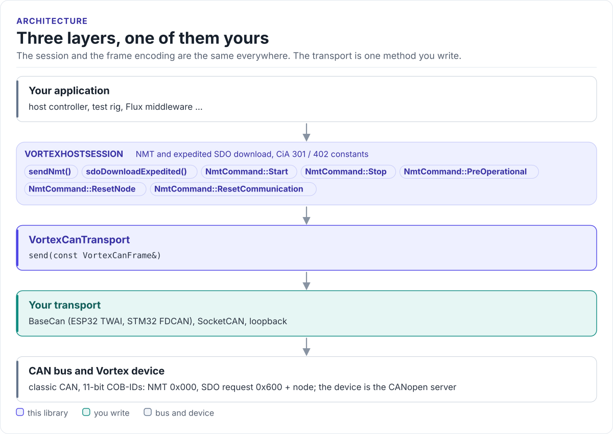
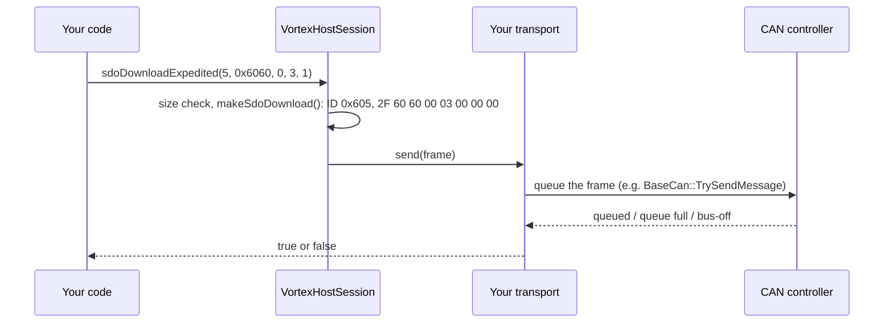

# Architecture

How the driver is put together: three layers, one of them yours, and what happens on one call.

<!-- figure: driver-layers -->
<picture>
  <source media="(prefers-color-scheme: dark)" srcset="diagrams/driver-layers.dark.svg">
  
</picture>
<!-- /figure -->

## Layers

| Layer | Files | Role |
| --- | --- | --- |
| Session | [`inc/vortex/VortexHostSession.hpp`](../inc/vortex/VortexHostSession.hpp), [`src/VortexHostSession.cpp`](../src/VortexHostSession.cpp) | Encodes NMT and expedited SDO download frames; holds only a reference to the transport |
| Protocol | [`inc/vortex/VortexProtocol.hpp`](../inc/vortex/VortexProtocol.hpp), [`inc/vortex/VortexCanFrame.hpp`](../inc/vortex/VortexCanFrame.hpp) | `NmtCommand`, object constants, the classic CAN frame type |
| Transport interface | [`inc/vortex/VortexCanTransport.hpp`](../inc/vortex/VortexCanTransport.hpp) | One pure-virtual method, `send()` |
| Your transport | your code | Puts a `VortexCanFrame` on a real bus (BaseCan, SocketCAN) or records it (tests) |

## One call through the layers

## Design choices

- **A virtual interface, not a template.** The transport is a runtime object, like the BNO08x and TMC9660
  transports elsewhere in HardFOC. One virtual call per frame is negligible next to the time an 8-byte frame
  takes on the wire (roughly 0.25 ms at 500 kbit/s).
- **No heap, no threads, no RTOS.** The session is one reference; frames are built on the stack.
- **Transmit only.** Receiving needs a thread or a callback, a filter and timeouts, which belong to the
  application or to a CANopen stack. The session stays a pure encoder.
- **Same bytes as hf-utils-canopen.** `VortexCanFrame` has the same fields as `CanFrame` in
  [hf-utils-canopen](https://github.com/hardfoc/hf-utils-canopen), and the NMT and SDO download encodings are
  the same CiA 301 layouts, so a field-by-field copy converts between them.

## Where it sits in HardFOC

| Layer | Repository | Uses this driver for |
| --- | --- | --- |
| Driver collection | [hf-core-drivers](https://github.com/hardfoc/hf-core-drivers) | Carries it as `external/hf-vortex-driver` |
| CANopen glue | [hf-core](https://github.com/hardfoc/hf-core) `handlers/common/canopen/` | BaseCan links and the CANopenNode driver for the device side |
| Device firmware | [hf-hal-vortex-v1](https://github.com/hardfoc/hf-hal-vortex-v1) | The Vortex board this driver talks to |

Next: [API guide](api-guide.md).
