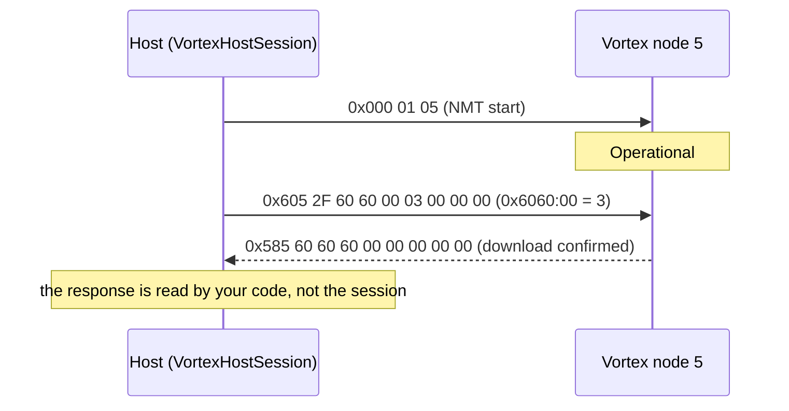

# Hardware

The bus the driver talks on: settings, identifiers, the exact bytes of each frame and the objects it names.

## Bus settings

| Setting | Value |
| --- | --- |
| Frame format | Classic CAN 2.0A: 11-bit identifier, no RTR, 0 to 8 data bytes (`VortexCanFrame`) |
| Bit rate | Set by your CAN controller, the same on every node; the Vortex V1 HAL uses 500 kbit/s |
| Node IDs | 1 to 127; NMT target 0 addresses every node |
| Termination | 120 Ω at each end of the bus |
| Vortex V1 controller | ESP32-C6 TWAI, TX on GPIO14, RX on GPIO15, transceiver standby on the PCAL95555 expander |

`VortexCanFrame` also carries `extended` and `rtr` flags; the session always sends them false.

## Identifiers

| Frame | COB-ID | Sent by this driver |
| --- | --- | --- |
| NMT command | `0x000` | Yes, `sendNmt()` |
| SDO request (client to server) | `0x600 + node` | Yes, `sdoDownloadExpedited()` |
| SDO response (server to client) | `0x580 + node` | No: read it yourself |
| Boot-up and heartbeat | `0x700 + node` | No |
| EMCY | `0x080 + node` | No |
| PDOs (default set) | `0x180 + node` to `0x500 + node` | No |

## NMT frame

ID `0x000`, DLC 2.

| Byte | Content |
| --- | --- |
| 0 | Command, from `NmtCommand` |
| 1 | Target node ID; 0 for all nodes |

<!-- generated: nmt-commands -->
| Command | Byte 0 |
| --- | --- |
| `NmtCommand::Start` | `0x01` |
| `NmtCommand::Stop` | `0x02` |
| `NmtCommand::PreOperational` | `0x80` |
| `NmtCommand::ResetNode` | `0x81` |
| `NmtCommand::ResetCommunication` | `0x82` |
<!-- /generated -->

## SDO expedited download frame

ID `0x600 + node`, DLC 8, little-endian.

| Byte | Content |
| --- | --- |
| 0 | Command specifier: `0x2F` for 1 byte, `0x2B` for 2 bytes, `0x23` for 4 bytes |
| 1, 2 | Index, low byte first |
| 3 | Sub-index |
| 4 to 7 | Value, low byte first; bytes past the size are 0 |

A size other than 1, 2 or 4 is refused before anything is sent.

## Object dictionary constants

The named objects in `VortexProtocol.hpp`. The node's object dictionary (its EDS, or the CANopenNode tables in the
device firmware) is authoritative.

<!-- generated: object-constants -->
| Constant | Value | Kind | Header comment |
| --- | --- | --- | --- |
| `kIdxErrorRegister` | `0x1001` | index | CiA 301 — Error register (0x1001) subindex 0 |
| `kIdxPredefError` | `0x1003` | index | CiA 301 — Pre-defined error field (0x1003) sub 0 = number of errors |
| `kIdxErrorBehavior` | `0x1029` | index | CiA 301 — Error behavior (0x1029); sub 1 = communication error |
| `kIdxControlword` | `0x6040` | index | CiA 402 — Controlword (0x6040) — used for drive state machine |
| `kIdxStatusword` | `0x6041` | index | CiA 402 — Statusword (0x6041) |
| `kIdxModesOfOperation` | `0x6060` | index | CiA 402 — Modes of operation (0x6060) |
| `kIdxModesDisplay` | `0x6061` | index | CiA 402 — Modes of operation display (0x6061) |
| `kIdxPosActual` | `0x6064` | index | CiA 402 — Position actual value (0x6064) |
| `kIdxVelActual` | `0x606C` | index | CiA 402 — Velocity actual value (0x606C) |
| `kIdxVendorBase` | `0x2000` | index | Proposed vendor range (HardFOC) — 0x2000–0x2FFF manufacturer-specific. Reserve sub-ranges as products solidify. |
| `kIdxVendorDeviceId` | `0x2000` | index | Example: 0x2000:01 — u32 build id / device magic (placeholder) |
| `kSubVendorDeviceId` | `0x01` | sub-index |  |

Source: [`inc/vortex/VortexProtocol.hpp`](../inc/vortex/VortexProtocol.hpp).
<!-- /generated -->

`tests/protocol` checks every index and NMT command byte in this table against CiA 301 and CiA 402 at compile
time ([Testing](testing.md)).

## Reference documents

| Document | What it defines |
| --- | --- |
| CiA 301 ([CAN in Automation](https://www.can-cia.org/)) | CANopen application layer: NMT, SDO, PDO, object dictionary |
| CiA 402 ([CAN in Automation](https://www.can-cia.org/)) | Drive profile: controlword, statusword, modes of operation |
| [Vortex V1 hardware](https://hardfoc.github.io/hf-hal-vortex-v1/latest/hardware/) | The board, its CAN pins and transceiver |

Next: [Architecture](architecture.md).
